# TempoPulse 节拍器

一款为 Android 打造的原生专业节拍器。界面、音频与交互全部使用 Android 框架实现，不依赖第三方运行时库，也没有网络权限、广告或数据收集。

- **版本**：1.3.1
- **包名**：`com.tempopulse.metronome`
- **支持系统**：Android 6.0（API 23）及以上
- **发布包**：`TempoPulse-1.3.1.apk`
- **界面语言**：简体中文（默认）/ English

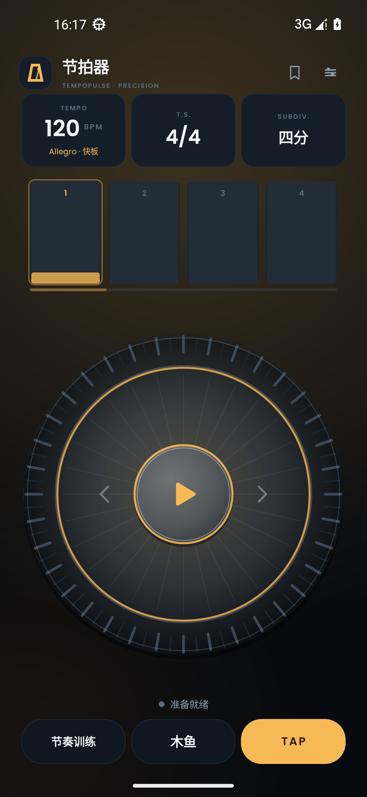

## 功能

### 速度与节拍
- **一体化中央旋钮**：滚花外圈旋转调节 BPM，中心是播放/暂停；左右 `‹ / ›` 微调 ±1；BPM 显示在上方速度卡。旋钮金属面已提亮，并移除了旧的内圈定位点。
- **速度感应 + 惯性**：2.2° / BPM 的慢速精细调节；超过约 120°/s 才开始加速，最高 1.5 倍；松手惯性最多 12 BPM，轻拨不再直接冲到最高速。
- **节拍柱**：每拍一根大柱，细分以格显示；当前拍从底部向上填充；**轻点节拍柱循环切换「普通 → 重音 → 静音」**。重音只保留边框和底部标记，不再给整列加底色。
- **目标速度**：点击 TEMPO 卡片，使用居中的数字键盘输入 20–500，或选择常用速度；数字不会滚动、拖动或截断。训练里的间隔、提升量和目标 BPM 也直接点数值输入。
- **TAP 轻点测速**：连续轻点自动取最近间隔计算 BPM。
- **15 种常用拍号 + 自定义拍号**：分子 1–16，分母 2/4/8/16，可设置 7/4、10/8、11/8、13/16 等；节拍柱最多显示 16 拍。
- **复合拍默认重音**：6/8、9/8、12/8（以及 6/4）自动按三拍分组设置重音，仍可逐拍修改。
- **细分**：四分、八分、三连音、十六分；细分使用独立的更轻音色。

### 节奏训练
- **主动开启**：默认关闭，只有点「开始训练」才生效；停止播放时训练和计时一起停止。
- **触发方式**：按时间（可自定义 5–600 秒，例如 30 秒或 2 分钟）或按小节（每 N 小节）。提速间隔、每次提升、目标 BPM 都点击数值直接输入。
- **提升方式**：每次固定 +BPM，或按百分比提升；提升量可自己设置。
- **目标与时长**：目标 BPM 可设置；达到目标后停止提速但继续播放。练习时长点开独立子菜单，提供 1/3/5 分钟和自定义；到时停止计时并结束播放。
- **后台执行**：训练在 `MetronomeService` 中运行，锁屏或切到后台仍继续按时间/小节推进，通知栏同步 BPM。

### 音色与播放
- **6 种合成音色**：木鱼、电子、牛铃、哔声、鼓棒、机械；每种都有**重音、弱拍、细分**三套独立波形。
- **低延迟音频引擎**：以采样点为时间基准排程节拍，不依赖线程唤醒；支持后台播放。
- **与其他音乐叠加**：使用 `USAGE_MEDIA` 但不抢占音频焦点，可和伴奏、录音一起播放。
- **通知控制**：前台服务 + 常驻通知，通知栏可直接停止；播放时持有 WakeLock。
- **音量**：0–100% 独立调节；最大输出增加 1.3x 主增益，响度更高。
- **视觉同步微调**：−100 到 +100 ms，补偿设备屏幕/音频延迟。

### 屏幕布局
- **顶部信息条**：去掉外层遮罩，TEMPO / T.S. / SUBDIV. 三块独立等宽等高；三块内容全部完整居中；这一栏更紧凑，给下方提示块让出空间。
- **手机竖屏**：单列演奏界面——顶栏、紧凑信息条、加高的节拍柱、中央旋钮、底部节奏训练/音色/TAP；主界面不滚动。
- **平板竖屏**：同样单列，但轮盘限制在约 58% 宽度，信息条和节拍柱加高，避免轮盘占比过大。
- **手机 / 平板横屏**：**40/60 两栏控制台**——左侧 40% 只有轮盘、填满宽度的五项图标工具栏（预设/设置/音色/训练/TAP）和播放状态；右侧 60% 上方是信息条，下方是节拍柱。训练改为图标，轮盘与工具栏之间保留 24dp 间距。
- **平板判断**：使用 `smallestScreenWidthDp >= 600` 区分平板；手机横屏和平板横屏共用 40/60 布局，只做尺寸适配。
- **详细设置**：设置面板分为「外观 / 播放 / 节拍」三页，单页无需上下拖动；三栏选中强调色和四个强调色圆点均居中。

### 触感与显示
- 节拍重音振动（可关）。
- 重拍全屏轻微闪光（可关）。
- 播放时保持屏幕常亮（默认开启）。
- 深色 / 浅色 / 跟随系统。
- 琥珀、青绿、珊瑚、紫罗兰 4 种强调色。
- 自定义速度预设：内置 3 个推荐练习速度，用户最多保存 20 个；预设包含 BPM、拍号、细分、音色与重音图案。

### 隐私
应用不声明 `INTERNET` 权限，不包含统计 SDK、广告或账号系统。所有设置与预设都只保存在本机 `SharedPreferences` 中。

## 安装

使用本地测试包 `TempoPulse-1.3.1.apk`（测试通过后再发布到 GitHub Releases）：

```bash
adb install -r TempoPulse-1.3.1.apk
```

也可以把 APK 复制到手机后直接打开安装（需允许安装未知来源应用）。

首次播放时，Android 13 及以上会请求通知权限；允许后可在通知栏中查看 BPM 并停止节拍器。即使拒绝通知权限，应用仍可正常播放，只是后台控制入口会受系统限制。

## 截图

| 主界面 | 播放中 |
| --- | --- |
|  | 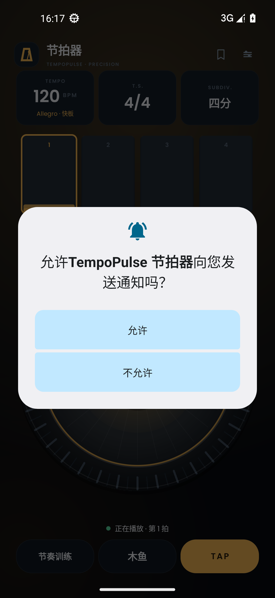 |

| 4:3 平板横屏 | 4:3 平板竖屏 |
| --- | --- |
| 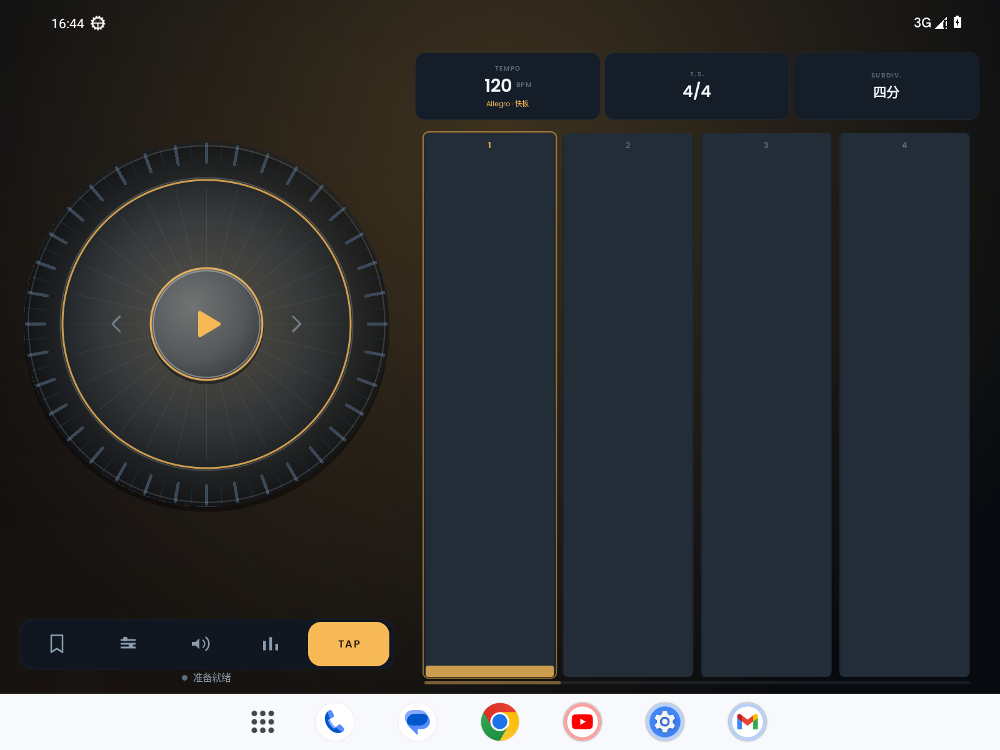 | 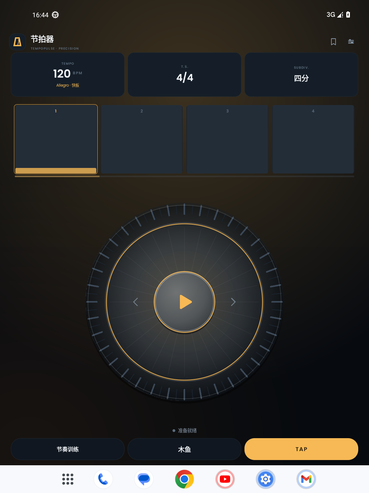 |

| 手机横屏 | 目标速度 |
| --- | --- |
| 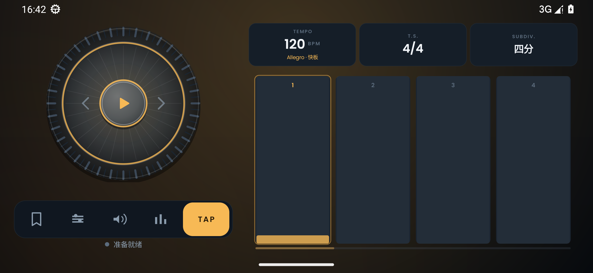 | 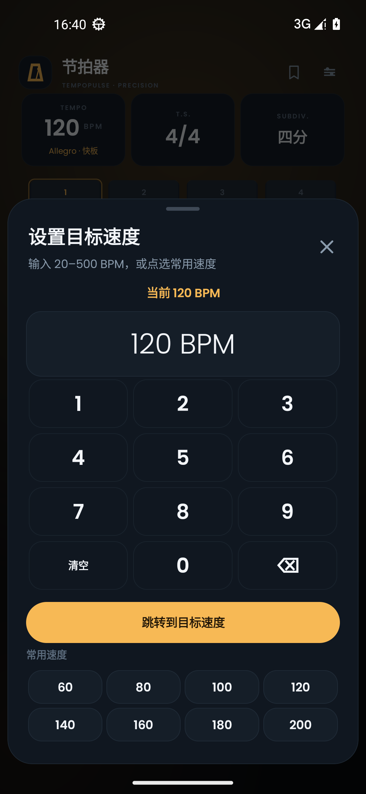 |

| 设置 | 拍号 |
| --- | --- |
| 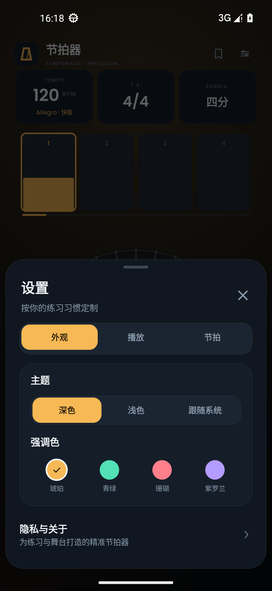 | 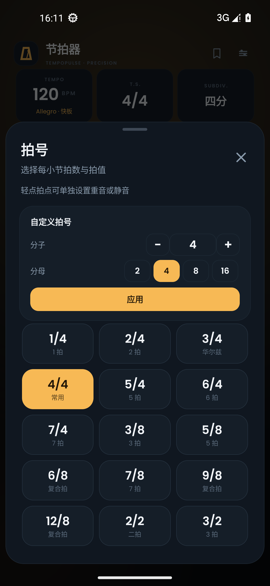 |

| 节奏训练 | 后台通知 |
| --- | --- |
| 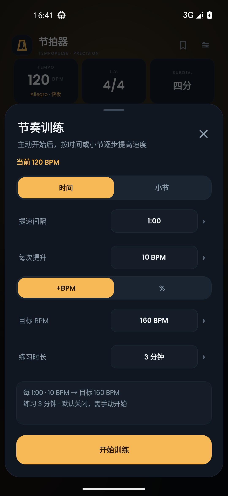 | 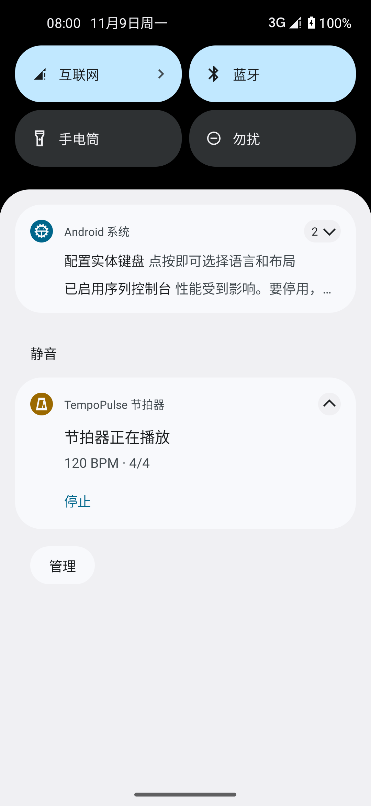 |

| 音色 | 速度预设 |
| --- | --- |
| 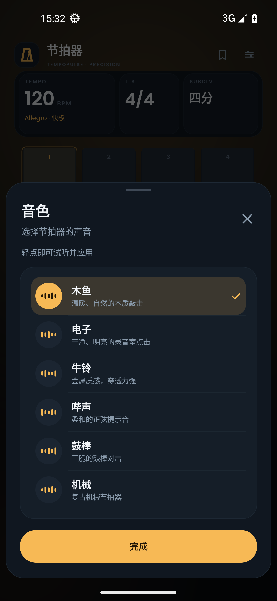 | 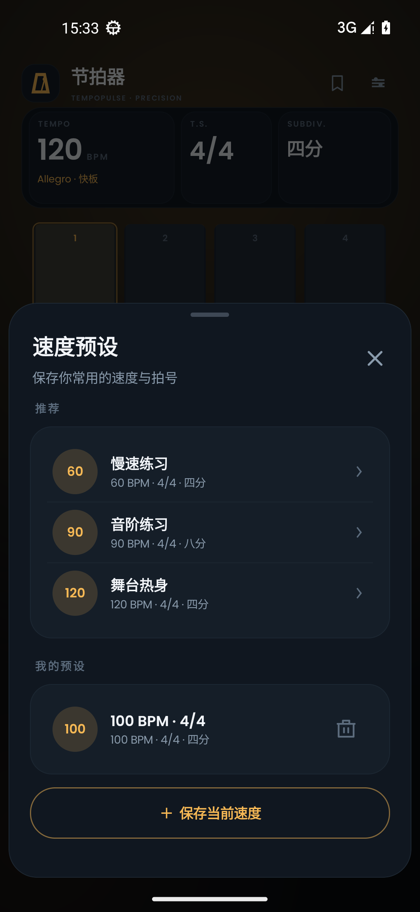 |

| 浅色主题 | 关于 |
| --- | --- |
| 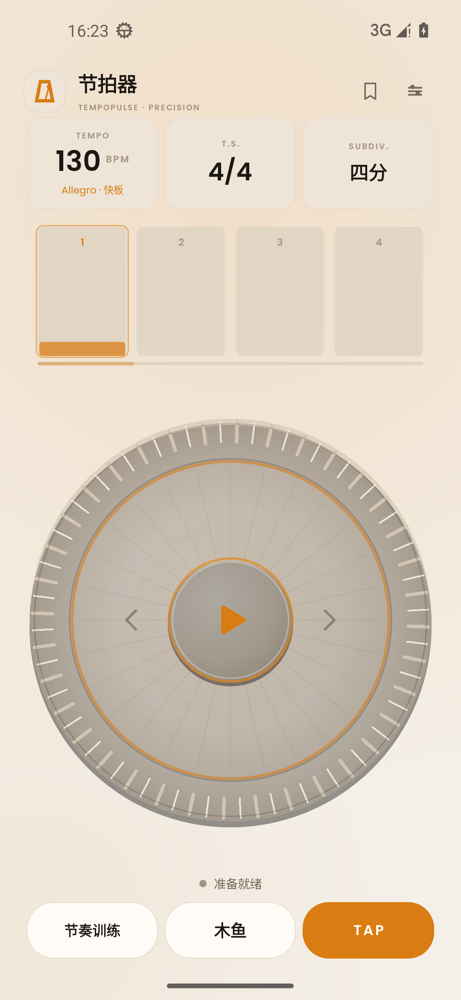 | 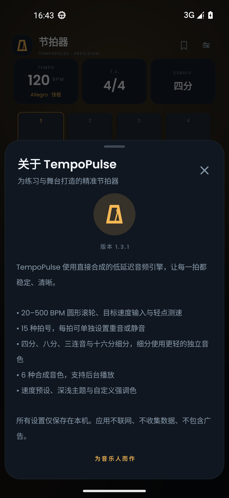 |


## 项目结构

```text
Metronome/
├─ app/src/main/
│  ├─ AndroidManifest.xml
│  ├─ java/com/tempopulse/metronome/
│  │  ├─ MainActivity.java          # 程序化 UI、底部面板、设置
│  │  ├─ MetronomeEngine.java       # 采样时钟音频引擎
│  │  ├─ ClickSynth.java            # 6 种音色实时合成
│  │  ├─ MetronomeService.java      # 前台服务、通知、振动
│  │  ├─ RotaryTempoView.java       # 中央旋钮：外圈调速、中心播放、±1
│  │  ├─ BeatBarsView.java          # 节拍柱、细分、点击切换重音
│  │  ├─ Prefs.java / Preset.java   # 本机设置与预设
│  │  └─ ...                        # Sheet / Dialog / 主题等
│  ├─ res/                          # 中文与英文资源、图标
│  └─ assets/fonts/                 # Poppins 字体及 OFL 许可证
├─ screenshots/                     # 模拟器实拍
├─ tools/build.ps1                  # 无 Gradle 构建脚本
├─ audio-preview.wav                # 音色与 120 BPM 时序试听
├─ README.md / README-zh.md
├─ LICENSE                          # MIT
└─ verification.txt
```

## 从源码构建

### 环境
- Windows PowerShell
- JDK 17
- Android SDK：Platform 35、Build-Tools 35.0.0、Platform-Tools
- Python 3（仅用于把 `classes.dex` 写入 APK）

### 构建

```powershell
Set-ExecutionPolicy -Scope Process -ExecutionPolicy Bypass
cd Metronome
.\tools\build.ps1 -Sdk "C:\Android\Sdk" -Clean
```

如果不传 `-Sdk`，脚本会依次读取 `ANDROID_SDK_ROOT`、`ANDROID_HOME`，最后回退到工作区中的 `tuner-work/android-sdk`。

脚本直接调用 `aapt2`、`javac`、`d8`、`zipalign`、`apksigner`，不依赖 Gradle 或 Maven。输出位于 `Metronome/TempoPulse-1.3.1.apk`。

### 签名说明

仓库不提交任何签名文件。首次执行构建脚本时，会在本地生成 `keystore/tempopulse.jks` 测试密钥（已被 `.gitignore` 忽略）：

```text
alias:       tempopulse
storePass:   tempopulse
keyPass:     tempopulse
```

正式发布到应用商店前，请替换成自己的 release keystore 并妥善保管。Release 中的 APK 已通过 v1 / v2 / v3 签名校验与 4 字节对齐。

## 音频引擎说明

- 音频线程持续向 `AudioTrack` 写入 48 kHz（或设备原生采样率）单声道 PCM。
- 节拍由全局采样帧位置计算，点击被叠加到精确的帧偏移上；BPM 改变只影响后续节拍，不重新启动音频流。
- 每拍围绕 `AudioTrack` 播放头计算视觉提示延迟，因此屏幕脉冲与实际声音保持同步；用户可进一步用「视觉同步微调」校准。
- `ClickSynth` 在启动时合成 6 组普通/重音/细分波形，普通与重音峰值归一化到 0.92，细分波形更短更轻。
- `audio-preview.wav` 是从同一套合成器离线渲染的 120 BPM、4/4、八分细分试听文件，包含 16 次主拍/细分交替，间隔精确为 0.250 s。
- 音色库为每种音色分别合成重音、弱拍、细分三套波形；细分波形更短、更轻，拥有独立音色，而不是简单降低弱拍音量。

> 本次验收环境为无声模拟器（emulator `-no-audio`），已验证 `AudioTrack` 正常初始化、前台服务/通知、UI 节拍回调和点击波形的不失真与时序；实际扬声器听感与设备端延迟仍需在真机上做最终确认。

## 已验证项目

- Android 13（API 33）x86_64 模拟器；手机竖屏 / 横屏，以及 4:3 平板 1600×1200、1200×1600（240 dpi）。
- 冷启动、无崩溃、无 `FATAL EXCEPTION`。
- 播放/停止、通知栏停止、后台继续播放。
- 中央旋钮慢速/快速旋转、速度感应、惯性滑行、中心播放/暂停、`‹ / ›` ±1、目标速度输入、TAP 测速。
- 拍号切换、复合拍重音、节拍柱点击切换重音/静音、细分切换。
- 6 种音色切换与试听、保存/加载/删除预设。
- 深色/浅色主题、强调色切换、设置三页标签。
- 手机竖屏、平板竖屏（轮盘限宽）、手机/平板横屏 40/60 两栏控制台；轮盘与图标工具栏留出间距。
- 主界面无 `ScrollView`，所有主要控件一屏可见。
- 中英文资源键对齐。

详细校验记录见 [`verification.txt`](verification.txt)。

## 许可证

本项目采用 [MIT License](LICENSE)。字体 Poppins 使用 SIL Open Font License 1.1，许可证文本位于 `app/src/main/assets/fonts/OFL.txt`。
