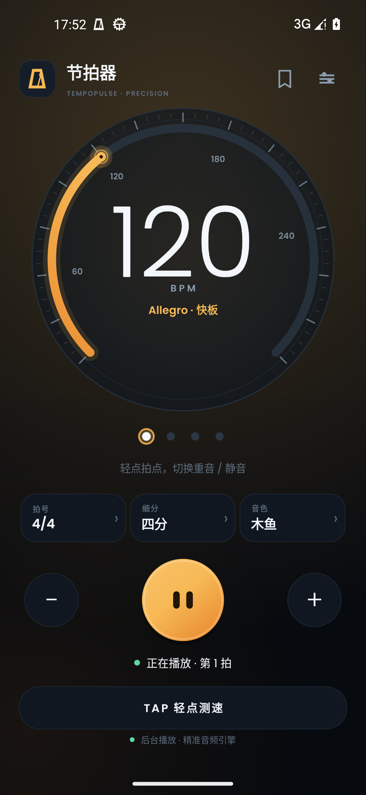
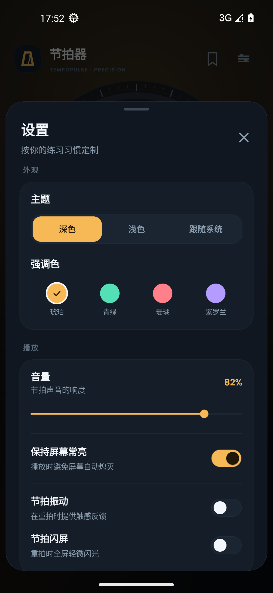
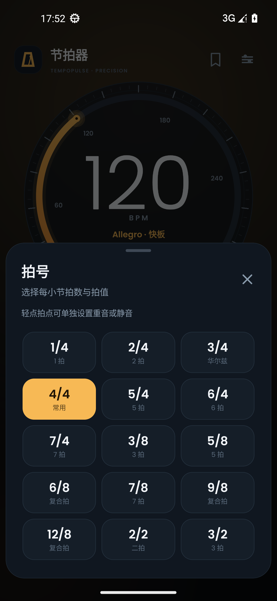
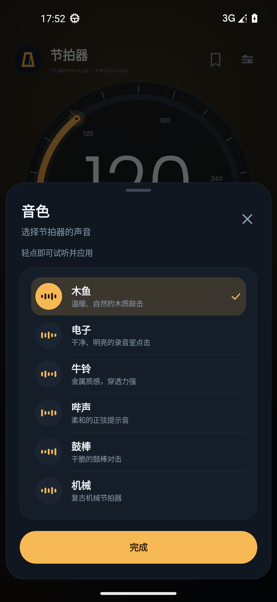
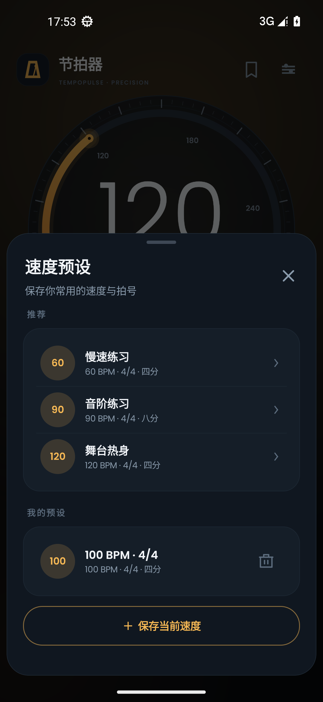
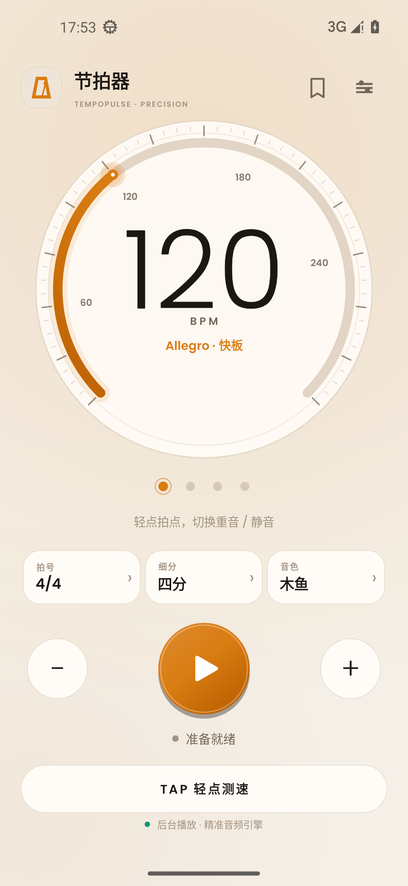
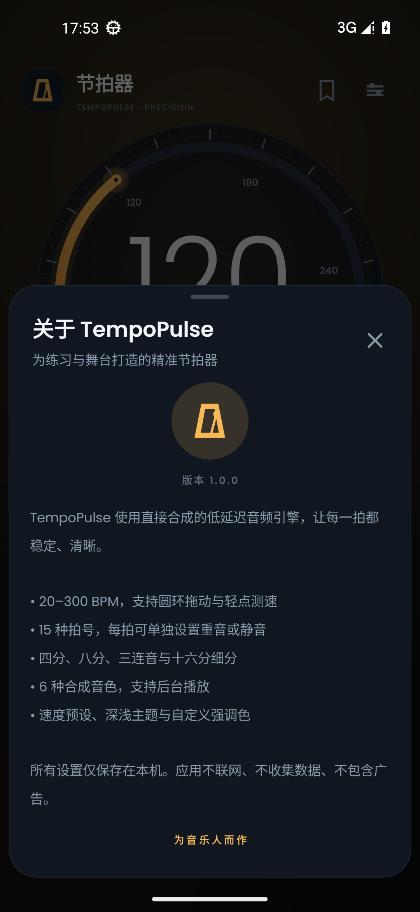
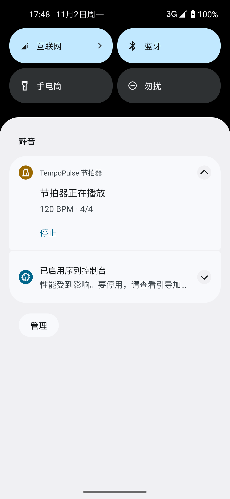

# TempoPulse 节拍器

一款为 Android 打造的原生专业节拍器。界面、音频与交互全部使用 Android 框架实现，不依赖第三方运行时库，也没有网络权限、广告或数据收集。

- **版本**：1.0.0
- **包名**：`com.tempopulse.metronome`
- **支持系统**：Android 6.0（API 23）及以上
- **发布包**：GitHub Releases（`TempoPulse-1.0.0.apk`）
- **界面语言**：简体中文（默认）/ English


## 功能

### 速度与节拍
- **20–300 BPM**，可拖动圆环、点按 `− / +`，长按连续加速。
- **TAP 轻点测速**：连续轻点自动取最近间隔计算 BPM。
- **15 种拍号**：1/4 到 12/8，包含 2/2、3/2 等。
- **每拍独立状态**：轻点拍点循环切换「普通 → 重音 → 静音」。
- **复合拍默认重音**：6/8、9/8、12/8（以及 6/4）自动按三拍分组设置重音，仍可逐拍修改。
- **细分**：四分、八分、三连音、十六分，每拍可细分到 4 个脉冲。

### 音色与播放
- **6 种合成音色**：木鱼、电子、牛铃、哔声、鼓棒、机械；每种都有单独的重音音色。
- **低延迟音频引擎**：以采样点为时间基准排程节拍，不依赖线程唤醒；支持后台播放。
- **与其他音乐叠加**：使用 `USAGE_MEDIA` 但不抢占音频焦点，可和伴奏、录音一起播放。
- **通知控制**：前台服务 + 常驻通知，通知栏可直接停止；播放时持有 WakeLock。
- **音量**：0–100% 独立调节。
- **视觉同步微调**：−100 到 +100 ms，补偿设备屏幕/音频延迟。

### 触感与显示
- 节拍重音振动（可关）。
- 重拍全屏轻微闪光（可关）。
- 播放时保持屏幕常亮（默认开启）。
- 深色 / 浅色 / 跟随系统。
- 琥珀、青绿、珊瑚、紫罗兰 4 种强调色。
- 自定义速度预设：内置 3 个推荐练习速度，用户最多保存 20 个；预设包含 BPM、拍号、细分、音色与重音图案。

### 隐私
应用不声明 `INTERNET` 权限，不包含统计 SDK、广告或账号系统。所有设置与预设都只保存在本机 `SharedPreferences` 中。

## 安装

从 GitHub Releases 下载 `TempoPulse-1.0.0.apk`，然后：

```bash
adb install -r TempoPulse-1.0.0.apk
```

也可以把 APK 复制到手机后直接打开安装（需允许安装未知来源应用）。

首次播放时，Android 13 及以上会请求通知权限；允许后可在通知栏中查看 BPM 并停止节拍器。即使拒绝通知权限，应用仍可正常播放，只是后台控制入口会受系统限制。

## 截图

| 主界面 | 播放中 |
| --- | --- |
|  |  |

| 设置 | 拍号 |
| --- | --- |
|  |  |

| 音色 | 速度预设 |
| --- | --- |
|  |  |

| 浅色主题 | 关于 |
| --- | --- |
|  |  |



## 项目结构

```text
Metronome/
├─ app/src/main/
│  ├─ AndroidManifest.xml
│  ├─ java/com/tempopulse/metronome/
│  │  ├─ MainActivity.java          # 程序化 UI、底部面板、设置
│  │  ├─ MetronomeEngine.java       # 采样时钟音频引擎
│  │  ├─ ClickSynth.java            # 6 种音色实时合成
│  │  ├─ MetronomeService.java      # 前台服务、通知、振动
│  │  ├─ TempoDialView.java         # BPM 圆环
│  │  ├─ BeatDotsView.java          # 每拍重音/静音
│  │  ├─ PlayButtonView.java        # 播放按钮
│  │  ├─ Prefs.java / Preset.java   # 本机设置与预设
│  │  └─ ...                        # Sheet / Dialog / 主题等
│  ├─ res/                          # 中文与英文资源、图标
│  └─ assets/fonts/                 # Poppins 字体及 OFL 许可证
├─ screenshots/                     # 模拟器实拍
├─ tools/build.ps1                  # 无 Gradle 构建脚本
├─ audio-preview.wav                # 音色与 120 BPM 时序试听
├─ README.md / README-zh.md
├─ LICENSE                          # MIT
└─ verification.txt
```

## 从源码构建

### 环境
- Windows PowerShell
- JDK 17
- Android SDK：Platform 35、Build-Tools 35.0.0、Platform-Tools
- Python 3（仅用于把 `classes.dex` 写入 APK）

### 构建

```powershell
Set-ExecutionPolicy -Scope Process -ExecutionPolicy Bypass
cd Metronome
.\tools\build.ps1 -Sdk "C:\Android\Sdk" -Clean
```

如果不传 `-Sdk`，脚本会依次读取 `ANDROID_SDK_ROOT`、`ANDROID_HOME`，最后回退到工作区中的 `tuner-work/android-sdk`。

脚本直接调用 `aapt2`、`javac`、`d8`、`zipalign`、`apksigner`，不依赖 Gradle 或 Maven。输出位于 `Metronome/TempoPulse-1.0.0.apk`。

### 签名说明

仓库不提交任何签名文件。首次执行构建脚本时，会在本地生成 `keystore/tempopulse.jks` 测试密钥（已被 `.gitignore` 忽略）：

```text
alias:       tempopulse
storePass:   tempopulse
keyPass:     tempopulse
```

正式发布到应用商店前，请替换成自己的 release keystore 并妥善保管。Release 中的 APK 已通过 v1 / v2 / v3 签名校验与 4 字节对齐。

## 音频引擎说明

- 音频线程持续向 `AudioTrack` 写入 48 kHz（或设备原生采样率）单声道 PCM。
- 节拍由全局采样帧位置计算，点击被叠加到精确的帧偏移上；BPM 改变只影响后续节拍，不重新启动音频流。
- 每拍围绕 `AudioTrack` 播放头计算视觉提示延迟，因此屏幕脉冲与实际声音保持同步；用户可进一步用「视觉同步微调」校准。
- `ClickSynth` 在启动时合成 6 组普通/重音波形，峰值归一化到 0.92，不使用外部采样文件。
- `audio-preview.wav` 是从同一套合成器离线渲染的 120 BPM、4/4、8 拍试听文件，峰值 −0.7 dBFS，节拍间隔精确为 0.500 s。

> 本次验收环境为无声模拟器（emulator `-no-audio`），已验证 `AudioTrack` 正常初始化、前台服务/通知、UI 节拍回调和点击波形的不失真与时序；实际扬声器听感与设备端延迟仍需在真机上做最终确认。

## 已验证项目

- Android 13（API 33）x86_64 模拟器，1080×2340、440 dpi、系统语言 zh-CN。
- 冷启动、无崩溃、无 `FATAL EXCEPTION`。
- 播放/停止、通知栏停止、后台继续播放。
- 圆环拖动、加减速、长按加速、TAP 测速。
- 拍号切换、复合拍重音、逐拍重音/静音、细分切换。
- 6 种音色切换与试听、保存/加载/删除预设。
- 深色/浅色主题、强调色切换。
- 中英文资源键 118/118 对齐。

详细校验记录见 [`verification.txt`](verification.txt)。

## 许可证

本项目采用 [MIT License](LICENSE)。字体 Poppins 使用 SIL Open Font License 1.1，许可证文本位于 `app/src/main/assets/fonts/OFL.txt`。
