# TempoPulse Metronome

A polished, native Android metronome built with Java and framework views. No third-party runtime dependencies, no ads, no analytics and no network permission.

**Version 1.3.1** restores the landscape balance to 40/60, replaces the training label with an icon, enlarges and re-spaces the training sheet, moves practice-length presets into their own submenu, makes interval/increment/target values directly editable, replaces the scrolling BPM field with a centred keypad, and normalises spacing across the main screens and sheets.

**中文说明：** [README-zh.md](README-zh.md)

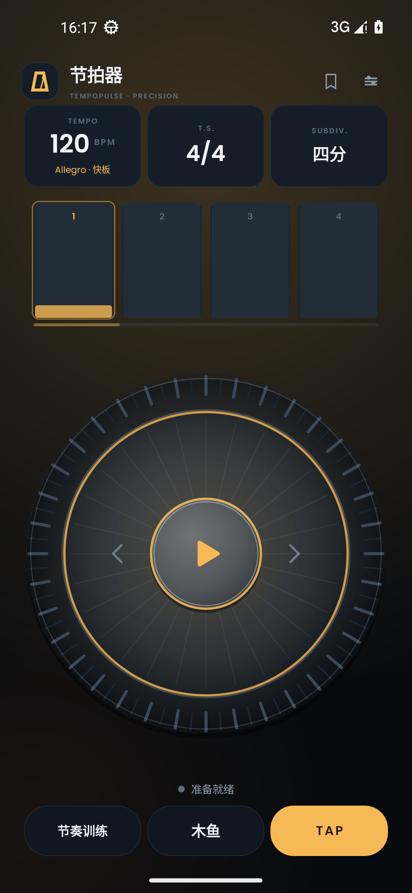

## Features

- **Practice trainer, opt-in**: nothing runs until the user presses Start. Time mode raises BPM every custom interval (5–600 s); bar mode raises it after N completed bars. Increment can be +BPM or +%; target is configurable; practice length has 1/3/5-minute presets and a custom value inside a dedicated submenu. Tapping interval, increment or target opens a centred number pad. Reaching the target stops further increases but keeps playing until the practice timer ends, then playback stops. Training runs in the foreground service, including with the screen off.
- **Compact information strip**: three separate equal-width TEMPO / T.S. / SUBDIV. buttons with no outer mask. All three values are fully centred; the strip is shorter in portrait and compact in landscape.
- **Integrated rotary tempo wheel**: the ridged outer ring turns for 1-BPM changes, the centre starts/stops playback, and the side chevrons fine-tune by ±1. BPM is displayed in the tempo strip and entered with a centred keypad.
- **Speed-adaptive wheel, retuned**: one BPM per 2.2° at low speed, acceleration only above about 120°/s and capped at 1.5x, with at most 12 BPM of inertial glide. The wheel no longer jumps to the ceiling on a small fast flick.
- **Beat-bar performance display**: one column per beat, with subdivision cells. Tap a column to cycle normal → accent → mute; the current beat fills from the bottom while playing. Accent uses an outline and bottom marker without a full-column tint.
- **Portrait single-stage layout**: compact info strip, taller beat bars, rotary wheel and bottom shortcuts fit on one screen. The old second 4/4 button is now the practice trainer shortcut. No vertical scrolling and no `−10/+10` strip.
- **Landscape 40/60 console**: the left 40% contains only the wheel, a full-width five-item icon dock (presets, settings, sound, training, TAP) and playback status; the right 60% has the information buttons above the beat bars. The wheel has 24dp of clearance above the dock.
- **Tablet portrait tuning**: the wheel is capped at roughly 58% of the available width, while the information strip and beat bars get more height.
- **Target tempo panel**: tap the TEMPO block for a centred three-digit keypad or a common-tempo grid. The display cannot scroll or drag; 20–500 BPM fits exactly.
- **Custom meters**: the meter sheet has a custom section with numerator 1–16 and denominator 2/4/8/16, so 7/4, 10/8, 11/8, 13/16 and similar signatures are available; 16 beat bars fit on the main screen.
- **15 common meters** remain as quick choices, with compound defaults for 6/8, 9/8 and 12/8.
- **BPM range 20–500**, with the full range available from the wheel, keypad, training target and presets.
- **Subdivisions**: quarter, eighth, triplets and sixteenths, with a separately synthesised, lighter subdivision timbre.
- **Six synthesised sounds**: woodblock, studio click, cowbell, soft beep, drumstick and mechanical. Each has separate accent, normal and subdivision variants.
- **Louder output**: a 1.3x master gain lifts maximum click level while keeping the existing volume slider.
- **Sample-clock audio engine**: clicks are scheduled by absolute audio frames, not by thread wake-ups.
- **Responsive 4:3 and landscape support**: phone and tablet layouts are selected with `smallestScreenWidthDp`; portrait, landscape and 4:3 orientations are covered.
- **Background playback** through a media foreground service, with a notification action to stop.
- **Works with music**: no audio-focus takeover, so it layers over backing tracks.
- **Presets**: three built-in practice tempos plus up to 20 user presets.
- **Tabbed settings**: Appearance / Playback / Beat pages, with symmetrically centred tab highlights and accent swatches.
- **Comfort features**: beat vibration, downbeat flash, keep-screen-awake, visual sync calibration, dark/light/system theme and four accent colours.
- **Chinese and English UI**, Android 6.0+.

## Install

Use the local **`TempoPulse-1.3.1.apk`** test build (the GitHub Release will be published after device testing):

```bash
adb install -r TempoPulse-1.3.1.apk
```

On Android 13+, allow notifications if you want to control playback from the notification shade.

## Screenshots

| Phone | Playing |
| --- | --- |
|  | 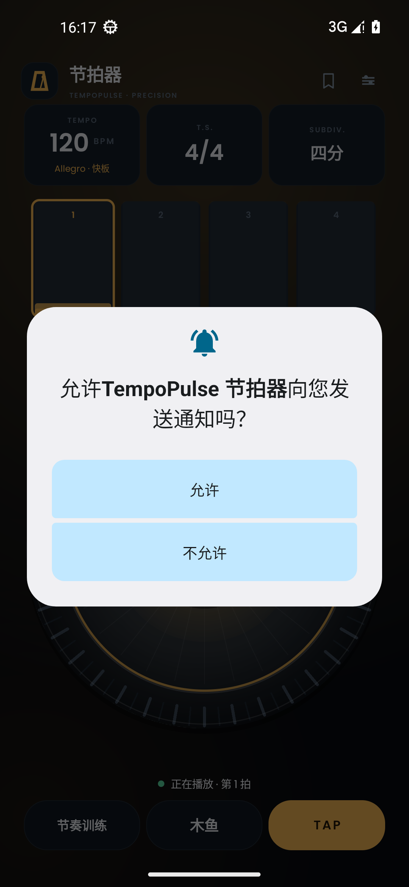 |

| 4:3 tablet landscape | 4:3 tablet portrait |
| --- | --- |
| 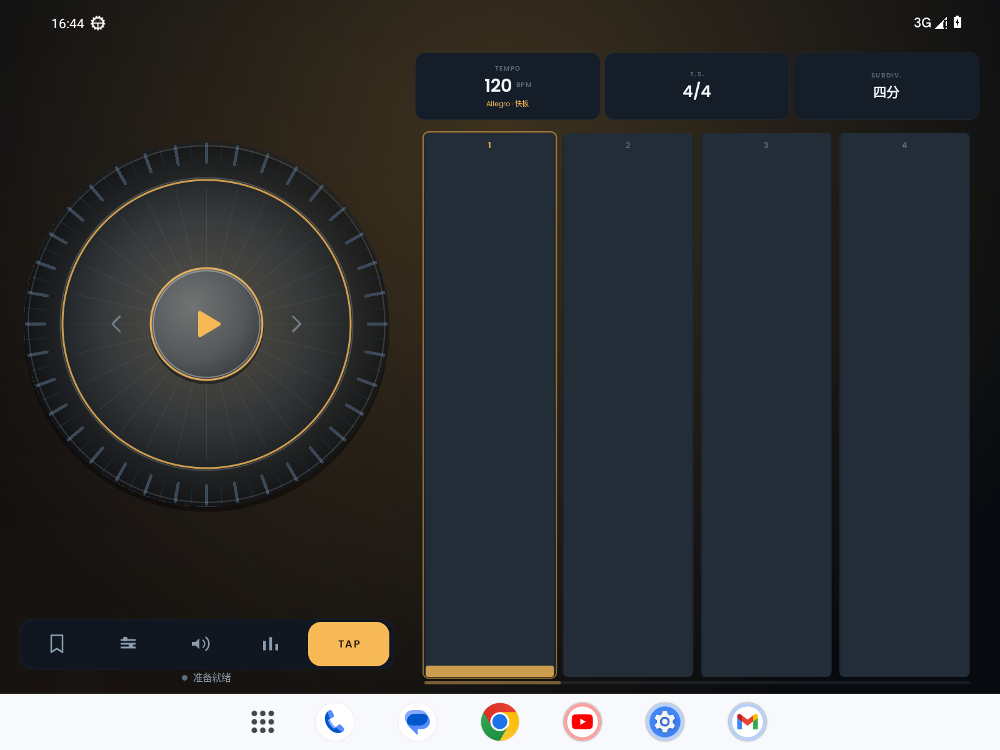 | 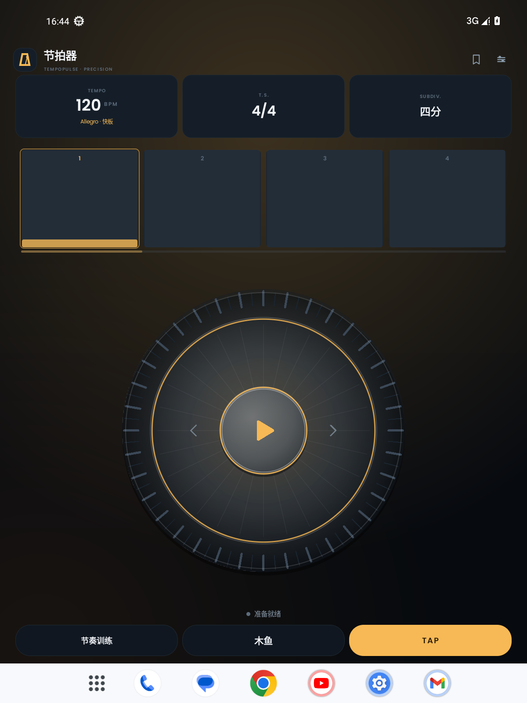 |

| Phone landscape | Target tempo |
| --- | --- |
| 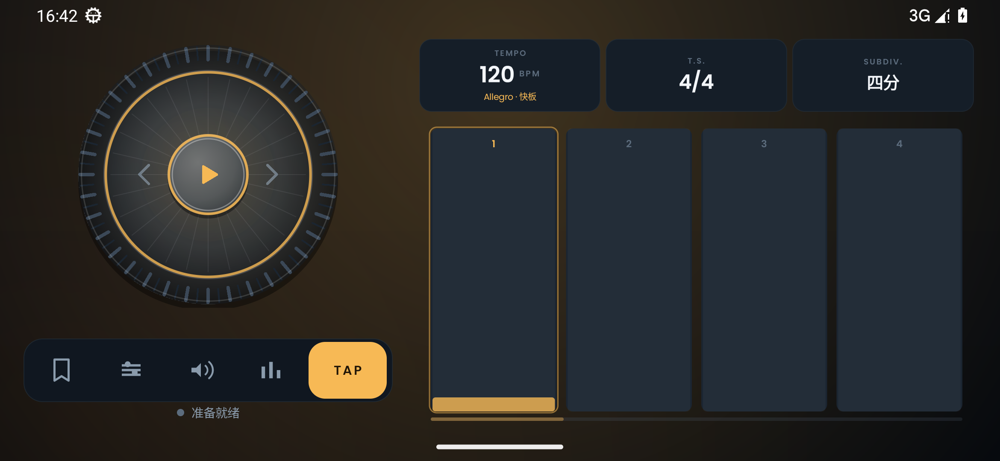 | 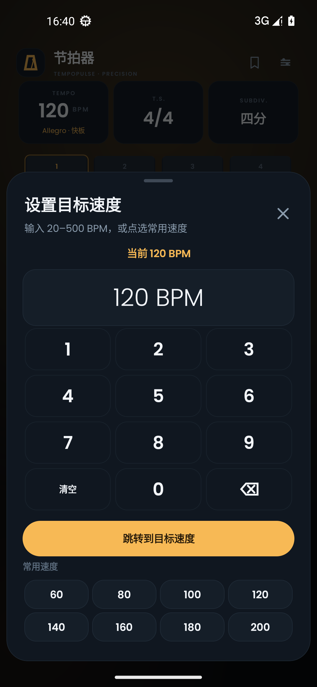 |

| Settings | Practice trainer |
| --- | --- |
| 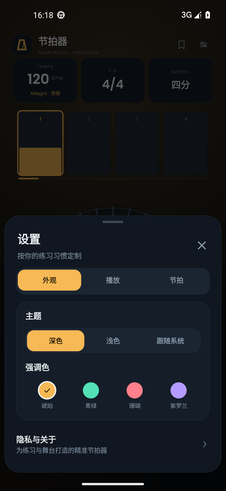 | 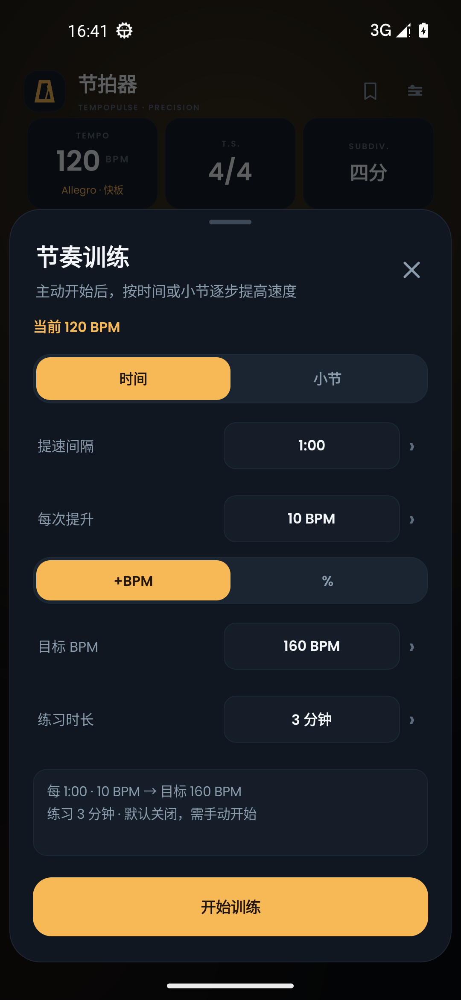 |

| Sound | Presets |
| --- | --- |
| 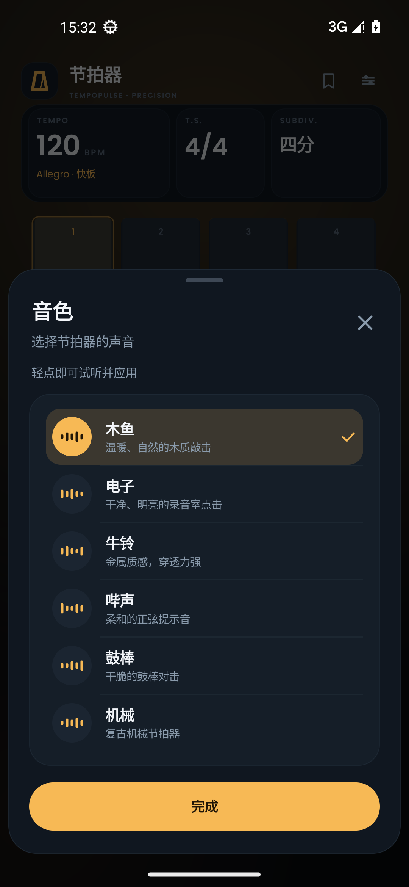 | 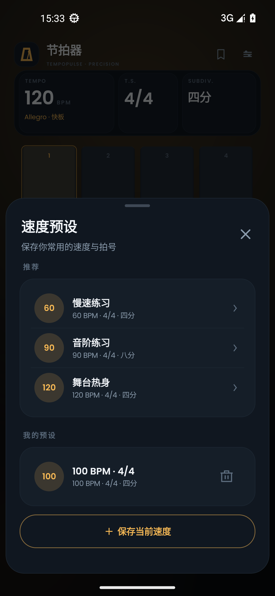 |

| Light | About |
| --- | --- |
| 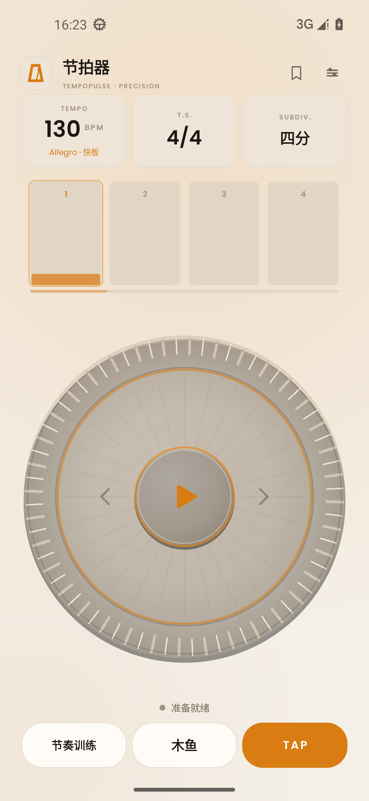 | 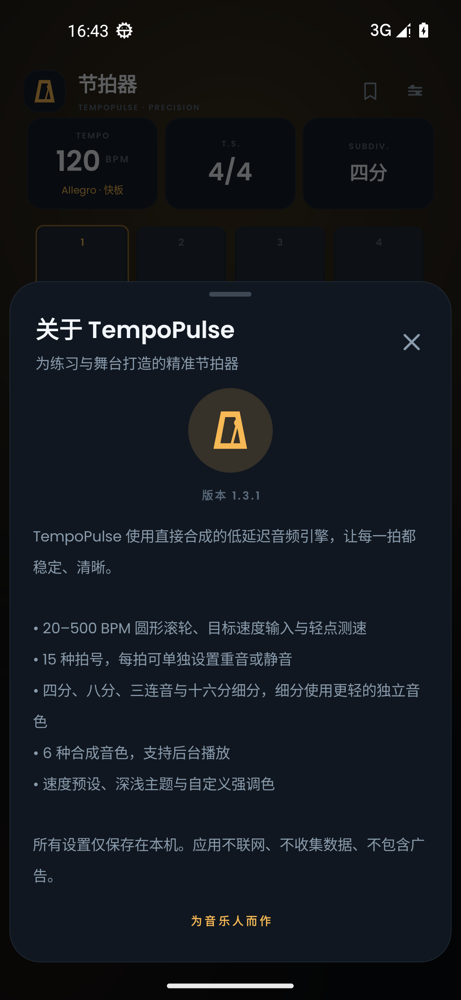 |

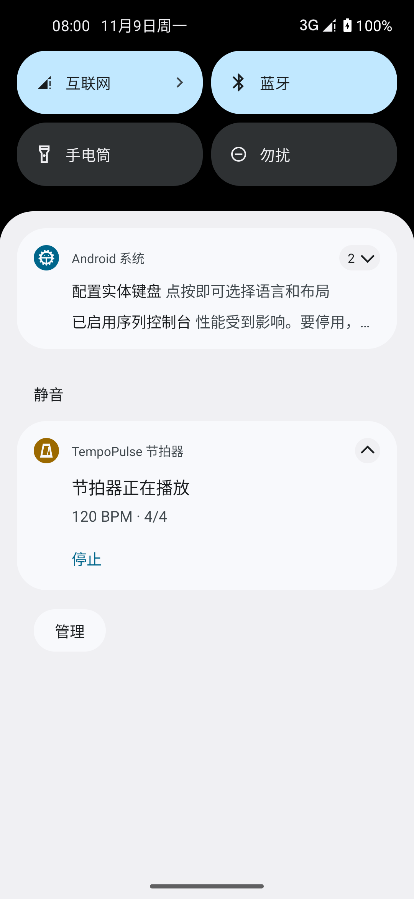

## Build

The project deliberately uses a small, dependency-free build script instead of Gradle.

Requirements:

- Windows PowerShell
- JDK 17
- Android SDK Platform 35 and Build-Tools 35.0.0
- Python 3

```powershell
Set-ExecutionPolicy -Scope Process -ExecutionPolicy Bypass
cd Metronome
.\tools\build.ps1 -Sdk "C:\Android\Sdk" -Clean
```

The script invokes `aapt2`, `javac`, `d8`, `zipalign` and `apksigner`, then writes `TempoPulse-1.3.1.apk`.

A local test keystore is generated on first build at `keystore/tempopulse.jks` and is intentionally ignored by Git. Replace it with your own release key before publishing to an app store.

## How the timing works

- A dedicated audio thread writes mono PCM to `AudioTrack` continuously.
- A global frame counter computes each click position. Tempo changes affect future beats without restarting the stream.
- Visual pulses are scheduled from the `AudioTrack` playback head, so the UI stays aligned with the audio clock. Users can fine-tune this with the visual-sync offset.
- All clicks are synthesised at runtime in `ClickSynth`; the repository contains no sampled audio. Every sound has three separately rendered variants: accent, normal and lighter subdivision.
- The tempo control is a rotary wheel: the ridged outer ring turns for 1-BPM steps, the centre transport starts/stops, and the chevrons step by ±1. Slow dragging is precise; fast dragging increases the BPM-per-degree ratio and ends with a short inertial glide.
- The main portrait and landscape stages have no `ScrollView`; landscape uses a 40/60 split, with the wheel and full-width five-item icon dock on the left and the information strip above the beat bars on the right.

`audio-preview.wav` is an offline render of the same synthesiser at 120 BPM / 4/4 with eighth-note subdivisions. It contains 16 alternating main/subdivision clicks at exactly 0.250 s intervals.

## Verification

Tested on an Android 13 (API 33) x86_64 emulator. Phone portrait/landscape and 4:3 tablet sizes (1600×1200 and 1200×1600 at 240 dpi) were exercised with a zh-CN locale:

- clean install and cold start without crashes;
- playback, stop, background service and notification action;
- rotary wheel slow/fast drag, acceleration, inertia, centre play/pause and ±1 arrows;
- slow rotary drag precision and reduced top-speed acceleration;
- target-tempo keypad and tap tempo, including 500 BPM and fully centred digits;
- custom meters 7/4, 10/8 and 16-beat display; taller training sheet with direct-value keypads and practice-length submenu;
- meter changes, compound accents, tap-to-cycle beat bars, subdivisions;
- six sounds, preset save/load/delete, tabbed settings with centred accent controls;
- 40/60 landscape console with the five-item icon dock on phone and tablet;
- practice trainer at a 30-second interval (120 → 130 BPM), remaining-time pill and opt-in start;
- 500 BPM range and slower 2.2°/BPM rotary curve;
- wheel clearance above the landscape dock;
- louder maximum output gain;
- tablet portrait capped wheel and reduced empty space;
- rotation while playing;
- no `ScrollView` and no clipped primary controls on the main screens;
- dark/light themes and accent colours.

The emulator was headless and launched with `-no-audio`, so speaker output still needs a final check on physical hardware. The synthesised PCM banks and the 120 BPM timing were verified offline. Full details are in [verification.txt](verification.txt).

## Credits

- Typeface: [Poppins](https://github.com/itfoundry/Poppins), SIL Open Font License 1.1. The license text is bundled at `app/src/main/assets/fonts/OFL.txt`.
- Designed and implemented as a native Android application using only the Android framework.

## License

This project is released under the MIT License. See [LICENSE](LICENSE).
