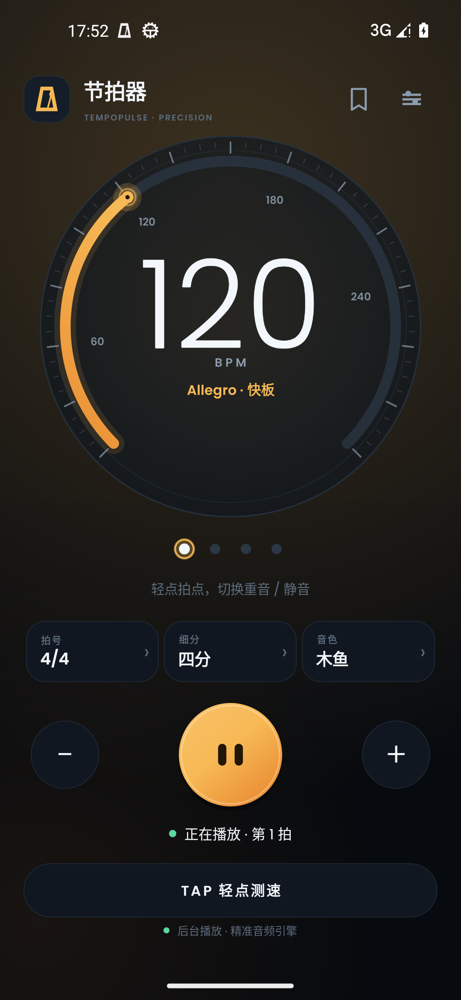
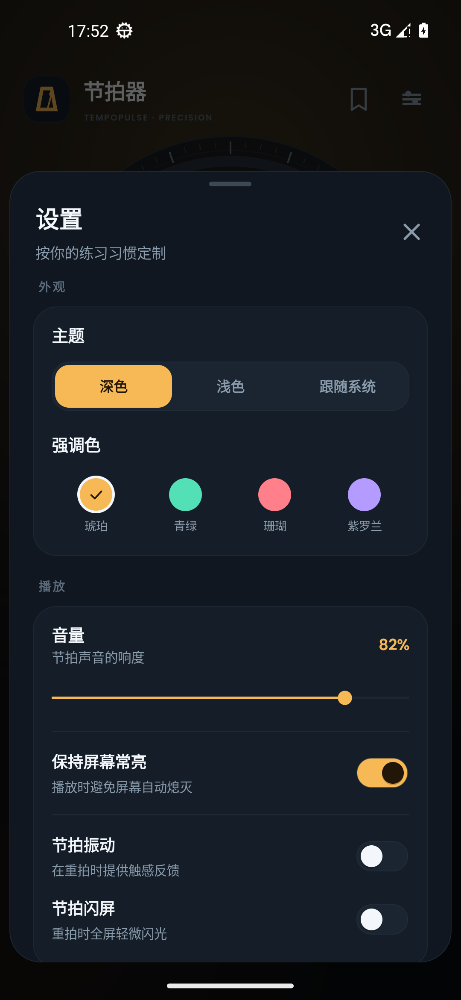
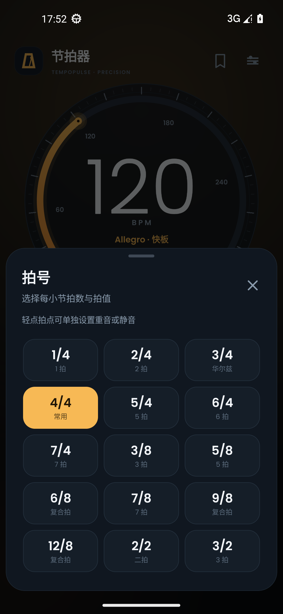
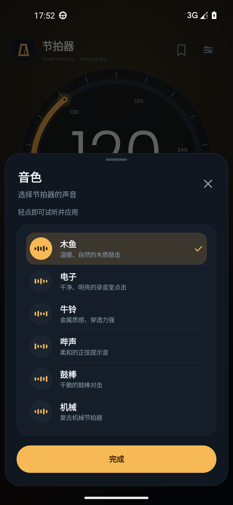
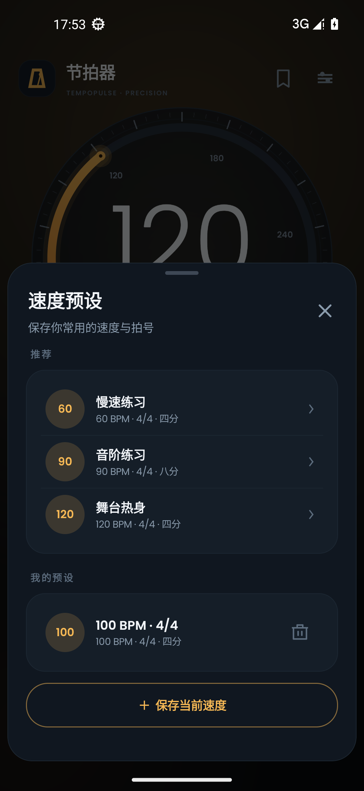

# TempoPulse Metronome

A polished, native Android metronome built with Java and framework views. No third-party runtime dependencies, no ads, no analytics and no network permission.

**中文说明：** [README-zh.md](README-zh.md)


## Features

- **20–300 BPM** with a draggable tempo wheel, ±1 controls, long-press acceleration and tap tempo.
- **15 time signatures**, from 1/4 to 12/8. Compound meters such as 6/8, 9/8 and 12/8 get sensible default accents.
- **Per-beat accents**: tap any beat to cycle normal → accent → mute. Patterns are stored with the preset.
- **Subdivisions**: quarter, eighth, triplets and sixteenths.
- **Six synthesised sounds**: woodblock, studio click, cowbell, soft beep, drumstick and mechanical. Each has a separate accented variant.
- **Sample-clock audio engine**: clicks are scheduled by absolute audio frames, not by thread wake-ups.
- **Background playback** through a media foreground service, with a notification action to stop.
- **Works with music**: no audio-focus takeover, so it layers over backing tracks.
- **Presets**: three built-in practice tempos plus up to 20 user presets.
- **Comfort features**: beat vibration, downbeat flash, keep-screen-awake, visual sync calibration, dark/light/system theme and four accent colours.
- **Chinese and English UI**, Android 6.0+.

## Install

Download the APK from the **Releases** page:

```bash
adb install -r TempoPulse-1.0.0.apk
```

On Android 13+, allow notifications if you want to control playback from the notification shade.

## Screenshots

| Main | Playing |
| --- | --- |
|  |  |

| Settings | Meter |
| --- | --- |
|  |  |

| Sound | Presets |
| --- | --- |
|  |  |

## Build

The project deliberately uses a small, dependency-free build script instead of Gradle.

Requirements:

- Windows PowerShell
- JDK 17
- Android SDK Platform 35 and Build-Tools 35.0.0
- Python 3

```powershell
Set-ExecutionPolicy -Scope Process -ExecutionPolicy Bypass
cd Metronome
.\tools\build.ps1 -Sdk "C:\Android\Sdk" -Clean
```

The script invokes `aapt2`, `javac`, `d8`, `zipalign` and `apksigner`, then writes `TempoPulse-1.0.0.apk`.

A local test keystore is generated on first build at `keystore/tempopulse.jks` and is intentionally ignored by Git. Replace it with your own release key before publishing to an app store.

## How the timing works

- A dedicated audio thread writes mono PCM to `AudioTrack` continuously.
- A global frame counter computes each click position. Tempo changes affect future beats without restarting the stream.
- Visual pulses are scheduled from the `AudioTrack` playback head, so the UI stays aligned with the audio clock. Users can fine-tune this with the visual-sync offset.
- All clicks are synthesised at runtime in `ClickSynth`; the repository contains no sampled audio.

`audio-preview.wav` is an offline render of the same synthesiser at 120 BPM / 4/4. Its measured click intervals are exactly 0.500 s.

## Verification

Tested on an Android 13 (API 33) x86_64 emulator at 1080×2340 with a zh-CN locale:

- clean install and cold start without crashes;
- playback, stop, background service and notification action;
- tempo wheel, tap tempo, long-press acceleration;
- meter changes, compound accents, per-beat mute/accent, subdivisions;
- six sounds and preset save/load/delete;
- dark/light themes and accent colours.

The emulator was headless and launched with `-no-audio`, so speaker output still needs a final check on physical hardware. The synthesised PCM banks and the 120 BPM timing were verified offline. Full details are in [verification.txt](verification.txt).

## Credits

- Typeface: [Poppins](https://github.com/itfoundry/Poppins), SIL Open Font License 1.1. The license text is bundled at `app/src/main/assets/fonts/OFL.txt`.
- Designed and implemented as a native Android application using only the Android framework.

## License

This project is released under the MIT License. See [LICENSE](LICENSE).
